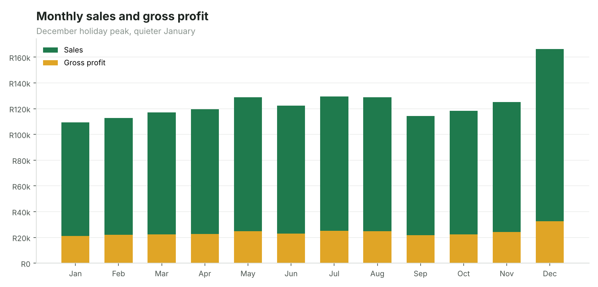
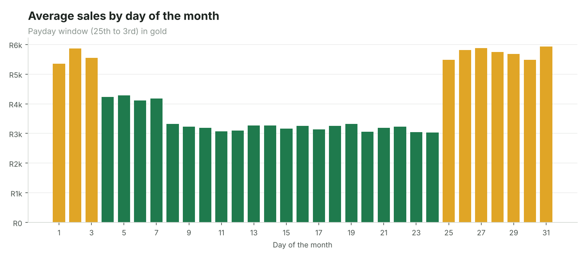
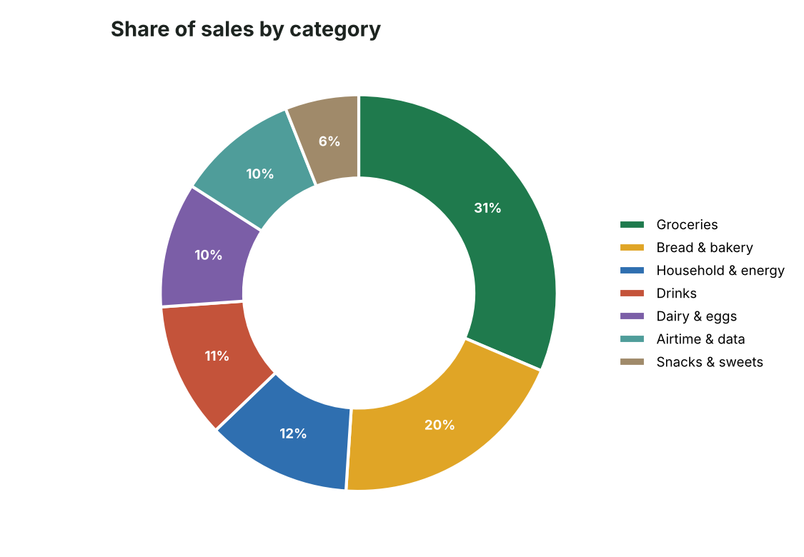
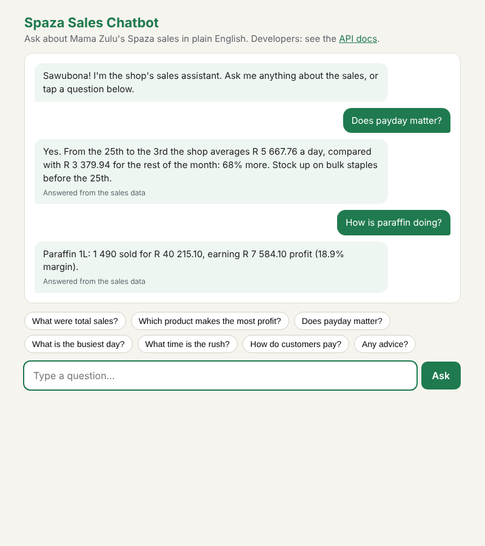

# Spaza Shop Sales Analyser

[](https://github.com/Ukhezo/spaza-sales-analyser/actions/workflows/tests.yml)


A Python and SQL tool that turns a spaza shop's sales records into answers a shop owner can act on: **what makes money, when customers shop, and what to stock.** It reads a sales CSV, analyses it with pandas and SQL (SQLite), draws charts with matplotlib and writes a full report. It also runs as a **web API (FastAPI)** with a **chatbot** that answers questions like *"Does payday matter?"*, packaged in a **Docker** container.



## What it found

Run on a year of sample sales for a fictional shop, *Mama Zulu's Spaza* in Greytown, KwaZulu-Natal:

- **R 1.49 million** in sales and **R 287 000** gross profit (19.2% margin).
- **Payday matters:** sales from the 25th to the 3rd are **68% higher** than the rest of the month, driven by bulk staples like maize meal, rice and cooking oil.
- **Bread and vetkoek earn the most profit.** They're cheap, but they sell every single day.
- **Airtime brings people in but barely pays:** a 6% margin, compared with about 19% for the shop overall.
- **Two daily rushes**, around 07:00 and 17:00, and weekends are the busiest days.
- **Seasonal swings:** paraffin and candles more than double in winter, while cold drinks peak in summer.
- **Cash is still king:** 58% of sales value is paid in cash, 26% by card and 16% by mobile wallet.

| Payday effect | Top products by profit |
|---|---|
|  |  |
| **When customers shop** | **Seasonal stock** |
|  |  |
| **Sales by category** | **How customers pay** |
|  |  |

The full generated report is in [`reports/report.md`](reports/report.md), every SQL query with its result is in [`reports/sql_results.md`](reports/sql_results.md), and the step-by-step analysis is in the [Jupyter notebook](notebooks/sales_analysis.ipynb).

## SQL analysis

The sales are loaded into a **SQLite database** with a normalised design:

| Table | One row per | Key columns |
|---|---|---|
| `products` | item on the shelf | `product_id` (PK), `name`, `category`, `unit_price`, `unit_cost` |
| `sales` | sale line | `sale_id` (PK), `receipt_id`, `sold_at`, `product_id` (FK → products), `quantity`, `payment_method` |

Ten saved queries in [`sql/queries/`](sql/queries) answer the business questions using `JOIN`s, `GROUP BY`, CTEs (`WITH`), `CASE`, date functions and window functions (`LAG`, `ROW_NUMBER`, running `SUM() OVER`):

| Query | SQL skills |
|---|---|
| [Headline numbers](sql/queries/01_headline_numbers.sql) | JOIN, aggregates, `COUNT(DISTINCT)` |
| [Monthly sales and change](sql/queries/02_monthly_sales.sql) | CTE, `STRFTIME`, `LAG()` |
| [Top 10 products](sql/queries/03_top_products.sql) | GROUP BY, ORDER BY, LIMIT |
| [Category share](sql/queries/04_category_share.sql) | `SUM() OVER ()` |
| [Payday effect](sql/queries/05_payday_effect.sql) | CTE, `CASE` |
| [Busiest weekdays](sql/queries/06_busiest_weekdays.sql) | CTE, date functions |
| [Best seller per category](sql/queries/07_best_seller_per_category.sql) | `ROW_NUMBER() OVER (PARTITION BY …)` |
| [Year-to-date running total](sql/queries/08_running_total.sql) | running `SUM() OVER (ORDER BY …)` |
| [Payment methods](sql/queries/09_payment_methods.sql) | aggregates, window share |
| [Winter vs summer products](sql/queries/10_winter_vs_summer.sql) | conditional aggregation |

Example — the payday effect:

```sql
WITH daily AS (
    SELECT DATE(s.sold_at)                            AS day,
           CAST(STRFTIME('%d', s.sold_at) AS INTEGER) AS day_of_month,
           SUM(s.quantity * p.unit_price)             AS revenue
    FROM sales AS s
    JOIN products AS p USING (product_id)
    GROUP BY day
)
SELECT CASE WHEN day_of_month >= 25 OR day_of_month <= 3
            THEN 'Payday (25th-3rd)' ELSE 'Rest of month' END AS period,
       COUNT(*)                AS days,
       ROUND(AVG(revenue), 2)  AS avg_daily_revenue
FROM daily
GROUP BY period;
```

| period | days | avg_daily_revenue |
|---|---|---|
| Payday (25th-3rd) | 113 | 5 667.76 |
| Rest of month | 252 | 3 379.94 |

Tests check that the SQL answers match the pandas answers exactly.

## Web API (FastAPI)

The analysis is also available as a web API, so other apps (a till system, a dashboard or a phone app) can ask for the numbers.

```bash
pip install -r requirements.txt
uvicorn spaza_analyser.api:app --reload
```

Then open **http://127.0.0.1:8000/docs** for interactive documentation where you can try every endpoint.

| Method | Endpoint | Returns |
|---|---|---|
| GET | `/health` | `{"status": "ok"}` if the API is running |
| GET | `/summary` | Sales, profit, margin, items sold, trading days |
| GET | `/insights` | Plain-language findings for the shop owner |
| GET | `/monthly` | Revenue, profit and margin per month |
| GET | `/products/top?n=10&by=profit` | Best products by `profit`, `revenue` or `units` |
| GET | `/products/slow?n=5` | Products earning the least |
| GET | `/categories` | Sales and margin per category |
| GET | `/patterns/weekdays` · `/patterns/hours` · `/patterns/payday` | When customers shop |
| GET | `/payments` | Cash vs card vs mobile wallet |
| POST | `/analyse` | Upload **your own** sales CSV and get a summary, insights and top products back |
| POST | `/chat` | Ask a question in plain English (see below) |

Example:

```bash
curl -X POST http://127.0.0.1:8000/chat \
     -H "Content-Type: application/json" \
     -d '{"question": "Does payday matter?"}'
```

```json
{
  "answer": "Yes. From the 25th to the 3rd the shop averages R 5 667.76 a day, compared with R 3 379.94 for the rest of the month: 68% more. Stock up on bulk staples before the 25th.",
  "topic": "payday",
  "mode": "rules"
}
```

The API serves `data/sales_2025.csv` by default; set the `SPAZA_DATA` environment variable to use another file. Uploads to `/analyse` are limited to 5 MB and checked with the same validation as the command-line tool.

## Chatbot

Open **http://127.0.0.1:8000** for a simple chat page with suggested questions.


 The chatbot ([`spaza_analyser/chatbot.py`](spaza_analyser/chatbot.py)) has two modes:

- **Rules mode (default, free, offline):** the question is matched to a topic by keywords ("payday", "busiest day", "bread"…) and the answer is built from the same analysis functions as the report. Every number comes from the data, so it can't invent anything.
- **AI mode (optional):** with `pip install -r requirements-ai.txt` and an `ANTHROPIC_API_KEY` environment variable, questions go to a Claude model together with a compact **data brief** of the shop's numbers, and the model is told to answer only from that brief. If the AI call fails, the bot falls back to rules mode.

**Why the extra care with AI:** a normal function always gives the same answer for the same input. A language model doesn't, and it can sound confident while being wrong. So AI mode is *grounded* in the data brief, and [`tests/test_chatbot.py`](tests/test_chatbot.py) holds an **evaluation set** of 15 questions with the facts each answer must contain. Rules mode is checked against it on every push; the AI-mode tests run when an API key is available.

## Run with Docker

```bash
docker build -t spaza-api .
docker run -p 8000:8000 spaza-api
# with AI mode:
docker run -p 8000:8000 -e ANTHROPIC_API_KEY=your-key spaza-api
```

The image is based on `python:3.12-slim`, runs as a non-root user and has a health check. GitHub Actions builds the image and checks `/health`, `/summary` and `/chat` on every push.

To run the container on Microsoft Azure (Container Apps), see [`docs/azure.md`](docs/azure.md), which also maps each step to the AZ-900 Azure Fundamentals topics and includes a 4-week study plan.

## Features

- **Data loading with validation:** clear errors for missing columns, bad dates or numbers, and negative quantities.
- **Analysis functions:** monthly trend, product and category performance, slow movers, weekday and hourly patterns, the payday effect, payment mix and seasonal products.
- **Plain-language insights:** findings written as sentences a shop owner can act on.
- **Eight charts** (bar, line, donut and pie) in one consistent style, with South African rand formatting (`R 1 234 567.89`).
- **Markdown report** with headline numbers, tables, charts and recommendations.
- **SQLite database and 10 SQL queries**, with results written to Markdown.
- **Command-line tools**, plus a **Jupyter notebook** that tells the story.
- **FastAPI web API** with 13 endpoints, including CSV upload, and interactive docs.
- **Chatbot** with a free rules mode and an optional AI mode grounded in the data.
- **Docker image** that runs as a non-root user, with a health check.
- **65 automated tests** (pytest): analysis, SQL vs pandas, every API endpoint and a chatbot evaluation set, plus linting (ruff). GitHub Actions runs them on every push and also builds and tests the Docker image.

## Quick start

```bash
git clone https://github.com/Ukhezo/spaza-sales-analyser.git
cd spaza-sales-analyser
pip install -r requirements.txt

python -m spaza_analyser data/sales_2025.csv --shop "Mama Zulu's Spaza, Greytown"
```

This prints the key findings and writes `reports/report.md` with all the charts.

To build the SQLite database and run all the SQL queries:

```bash
python -m spaza_analyser.sql_report data/sales_2025.csv
```

This creates `data/spaza.db` (open it with any SQLite tool, e.g. DB Browser for SQLite) and writes `reports/sql_results.md`.

| Option | What it does | Default |
|---|---|---|
| `--out` | Folder for the report and charts | `reports` |
| `--shop` | Shop name used in the report title | `Spaza shop` |
| `--top` | How many top products to list | `10` |

### Use your own sales

Any CSV with these columns works:

| Column | Example |
|---|---|
| `receipt_id` | `R100245` |
| `timestamp` | `2025-03-28 17:42` |
| `product` | `White bread loaf` |
| `category` | `Bread & bakery` |
| `quantity` | `2` |
| `unit_price` | `19.99` |
| `unit_cost` | `16.50` |
| `payment_method` | `Cash` |

### Run the tests

```bash
pip install -r requirements-dev.txt
pytest
ruff check .
```

To also run the chatbot evaluation against AI mode:

```bash
pip install -r requirements-ai.txt
ANTHROPIC_API_KEY=your-key pytest tests/test_chatbot.py
```

### Regenerate the sample data

```bash
python scripts/generate_sample_data.py --out data/sales_2025.csv --seed 42
```

## About the data

The sales data is **synthetic**: it was generated to behave like a real township shop, with payday spikes, busier weekends, a December peak and seasonal products, but no real shop or customer is involved. See [`scripts/generate_sample_data.py`](scripts/generate_sample_data.py) for the rules used.

## Project structure

```
spaza-sales-analyser/
├── spaza_analyser/
│   ├── data.py           # load and validate the CSV, add revenue/cost/profit
│   ├── analysis.py       # the business questions, answered with pandas
│   ├── charts.py         # matplotlib charts
│   ├── report.py         # Markdown report writer
│   ├── database.py       # build the SQLite database, run saved queries
│   ├── sql_report.py     # SQL command-line tool
│   ├── cli.py            # command-line entry point
│   ├── api.py            # FastAPI web API
│   ├── chatbot.py        # chatbot: rules mode + optional AI mode
│   └── static/chat.html  # chat page served at /
├── data/sales_2025.csv   # one year of sample sales (57 829 lines)
├── sql/
│   ├── schema.sql        # products + sales tables
│   └── queries/          # 10 saved SQL queries
├── notebooks/            # Jupyter notebook walkthrough
├── reports/              # generated report and charts
├── scripts/              # sample data generator
├── tests/                # pytest suite, incl. API tests and chatbot evaluation set
├── docs/azure.md         # deploy to Azure + AZ-900 study plan
├── Dockerfile            # container for the API
└── .github/workflows/    # CI: lint + tests on Python 3.10 and 3.12, Docker build and smoke test
```

## Built with

Python · SQL (SQLite) · pandas · matplotlib · FastAPI · Docker · Claude API (optional) · pytest · ruff · Jupyter · GitHub Actions

## Possible next steps

- Stock reorder alerts based on sales speed
- An interactive dashboard (Streamlit)
- Deploy the API to Azure Container Apps ([guide](docs/azure.md))
- Read sales straight from a till system or Google Sheet

## License

[MIT](LICENSE) © 2026 Ukhezo
