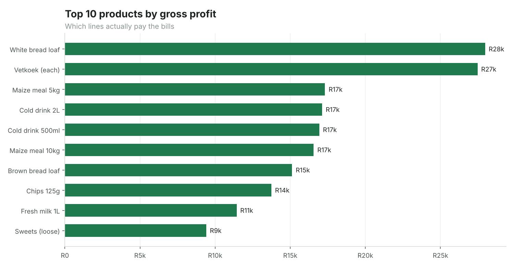
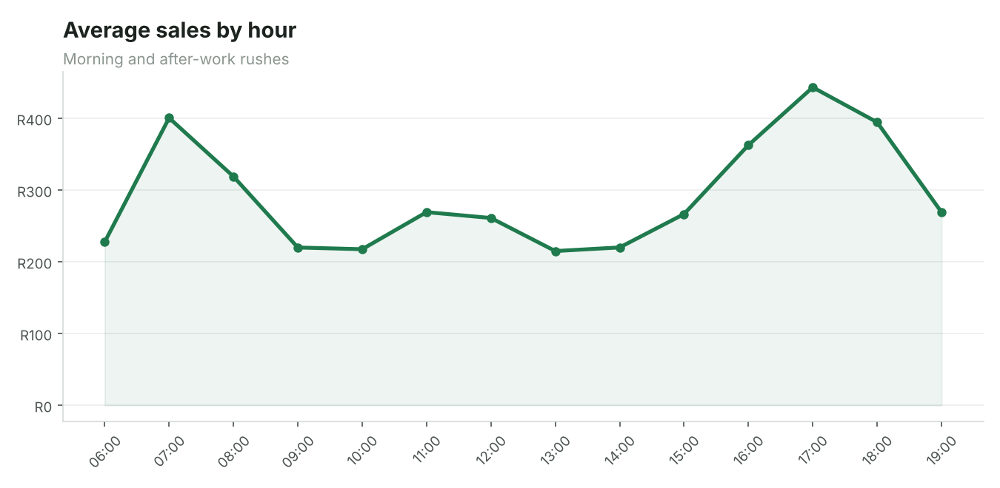
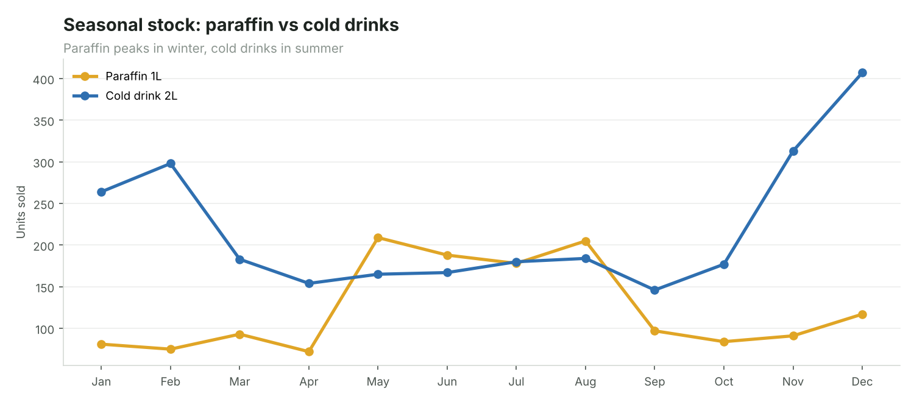
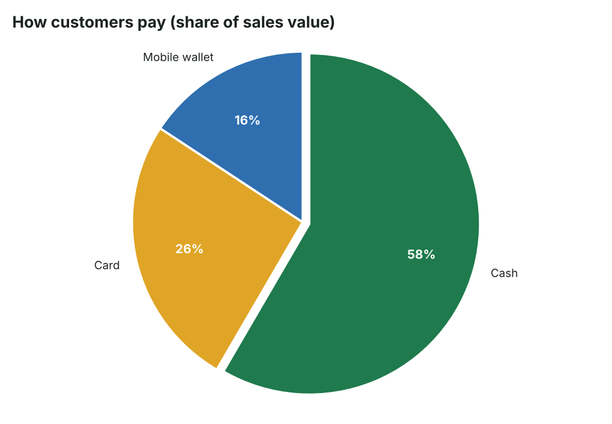

# Spaza Shop Sales Analyser

[](https://github.com/Ukhezo/spaza-sales-analyser/actions/workflows/tests.yml)


A Python tool that turns a spaza shop's sales records into answers a shop owner can act on: **what makes money, when customers shop, and what to stock.** It reads a sales CSV, analyses it with pandas, draws charts with matplotlib and writes a full report.


## What it found

Run on a year of sample sales for a fictional shop, *Mama Zulu's Spaza* in Greytown, KwaZulu-Natal:

- **R 1.49 million** in sales and **R 287 000** gross profit (19.2% margin).
- **Payday matters:** sales from the 25th to the 3rd are **68% higher** than the rest of the month, driven by bulk staples like maize meal, rice and cooking oil.
- **Bread and vetkoek earn the most profit.** They're cheap, but they sell every single day.
- **Airtime brings people in but barely pays:** a 6% margin, compared with about 19% for the shop overall.
- **Two daily rushes**, around 07:00 and 17:00, and weekends are the busiest days.
- **Seasonal swings:** paraffin and candles more than double in winter, while cold drinks peak in summer.
- **Cash is still king:** 58% of sales value is paid in cash, 26% by card and 16% by mobile wallet.

| Payday effect | Top products by profit |
|---|---|
|  |  |
| **When customers shop** | **Seasonal stock** |
|  |  |
| **Sales by category** | **How customers pay** |
|  |  |

The full generated report is in [`reports/report.md`](reports/report.md), and the step-by-step analysis is in the [Jupyter notebook](notebooks/sales_analysis.ipynb).

## Features

- **Data loading with validation:** clear errors for missing columns, bad dates or numbers, and negative quantities.
- **Analysis functions:** monthly trend, product and category performance, slow movers, weekday and hourly patterns, the payday effect, payment mix and seasonal products.
- **Plain-language insights:** findings written as sentences a shop owner can act on.
- **Eight charts** (bar, line, donut and pie) in one consistent style, with South African rand formatting (`R 1 234 567.89`).
- **Markdown report** with headline numbers, tables, charts and recommendations.
- **Command-line tool**, plus a **Jupyter notebook** that tells the story.
- **19 automated tests** (pytest) and linting (ruff), run on every push with GitHub Actions.

## Quick start

```bash
git clone https://github.com/Ukhezo/spaza-sales-analyser.git
cd spaza-sales-analyser
pip install -r requirements.txt

python -m spaza_analyser data/sales_2025.csv --shop "Mama Zulu's Spaza, Greytown"
```

This prints the key findings and writes `reports/report.md` with all the charts.

| Option | What it does | Default |
|---|---|---|
| `--out` | Folder for the report and charts | `reports` |
| `--shop` | Shop name used in the report title | `Spaza shop` |
| `--top` | How many top products to list | `10` |

### Use your own sales

Any CSV with these columns works:

| Column | Example |
|---|---|
| `receipt_id` | `R100245` |
| `timestamp` | `2025-03-28 17:42` |
| `product` | `White bread loaf` |
| `category` | `Bread & bakery` |
| `quantity` | `2` |
| `unit_price` | `19.99` |
| `unit_cost` | `16.50` |
| `payment_method` | `Cash` |

### Run the tests

```bash
pip install -r requirements-dev.txt
pytest
ruff check .
```

### Regenerate the sample data

```bash
python scripts/generate_sample_data.py --out data/sales_2025.csv --seed 42
```

## About the data

The sales data is **synthetic**: it was generated to behave like a real township shop, with payday spikes, busier weekends, a December peak and seasonal products, but no real shop or customer is involved. See [`scripts/generate_sample_data.py`](scripts/generate_sample_data.py) for the rules used.

## Project structure

```
spaza-sales-analyser/
├── spaza_analyser/
│   ├── data.py           # load and validate the CSV, add revenue/cost/profit
│   ├── analysis.py       # the business questions, answered with pandas
│   ├── charts.py         # matplotlib charts
│   ├── report.py         # Markdown report writer
│   └── cli.py            # command-line entry point
├── data/sales_2025.csv   # one year of sample sales (57 829 lines)
├── notebooks/            # Jupyter notebook walkthrough
├── reports/              # generated report and charts
├── scripts/              # sample data generator
├── tests/                # pytest suite
└── .github/workflows/    # CI: lint + tests on Python 3.10 and 3.12
```

## Built with

Python · pandas · matplotlib · pytest · ruff · Jupyter · GitHub Actions

## Possible next steps

- Stock reorder alerts based on sales speed
- An interactive dashboard (Streamlit)
- Read sales straight from a till system or Google Sheet

## License

[MIT](LICENSE) © 2026 Ukhezo
