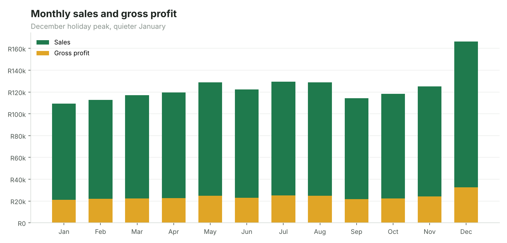
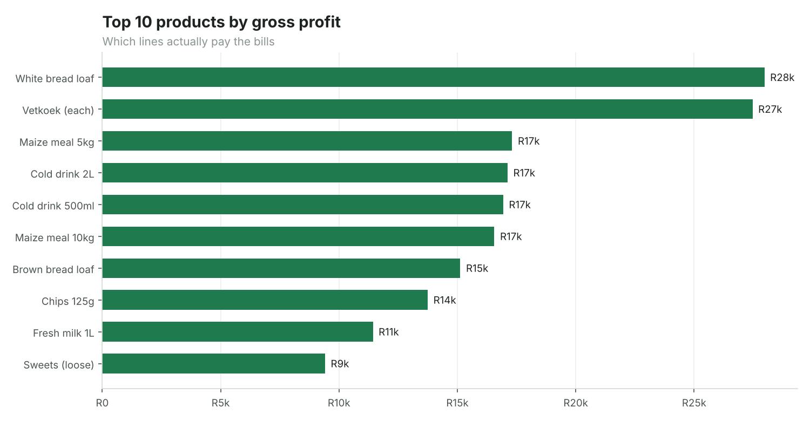
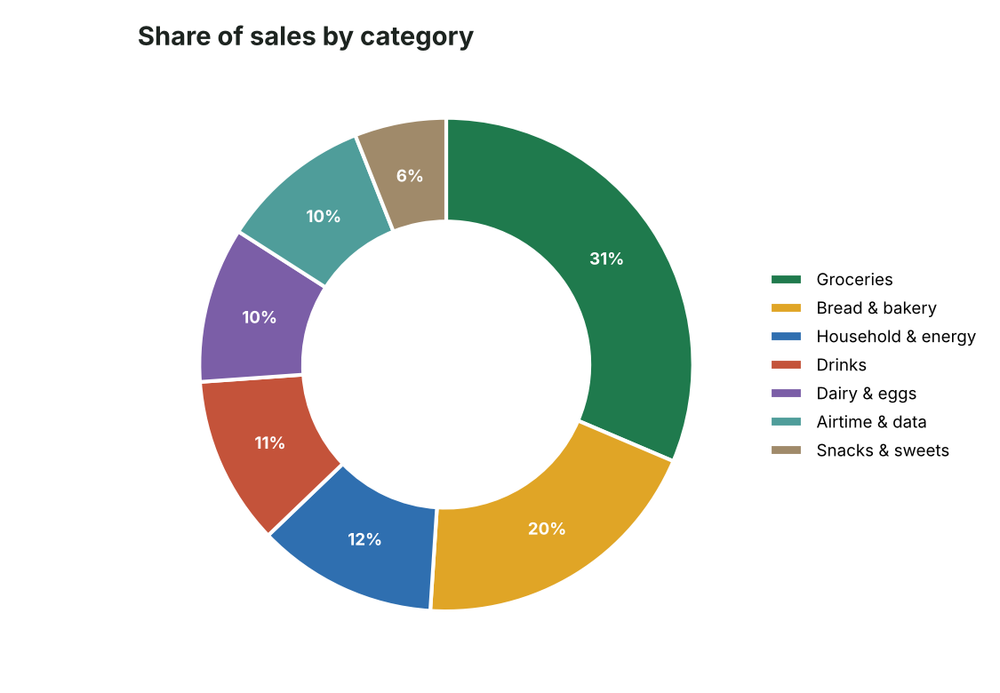
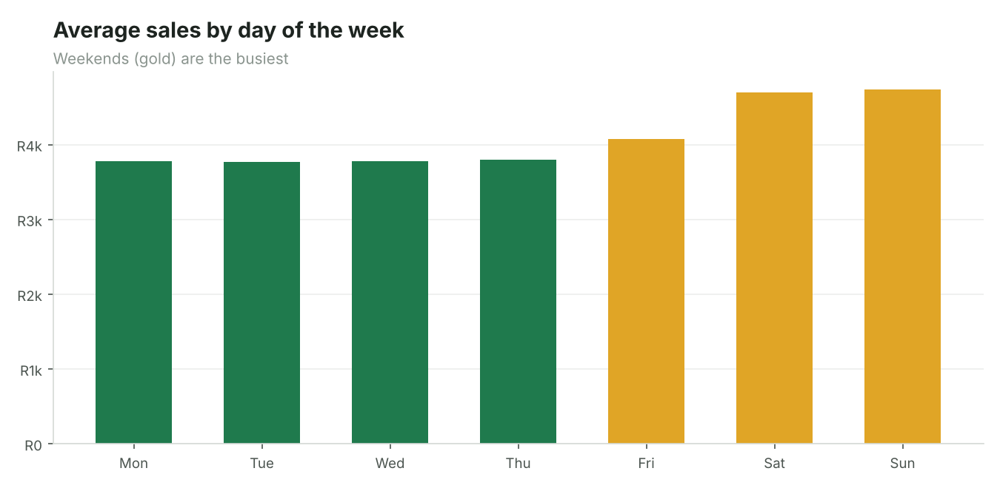
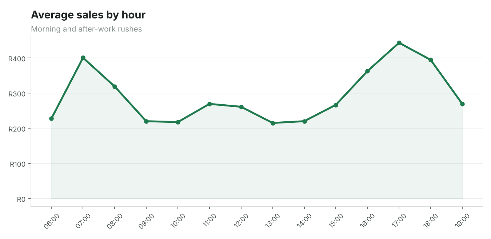
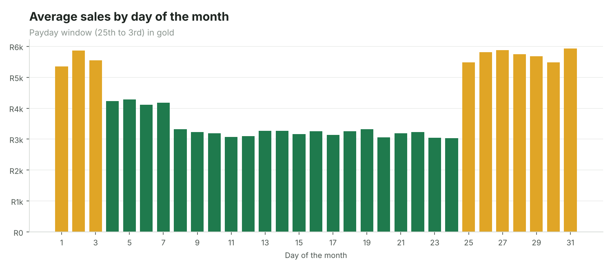
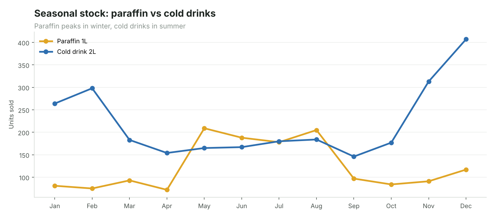
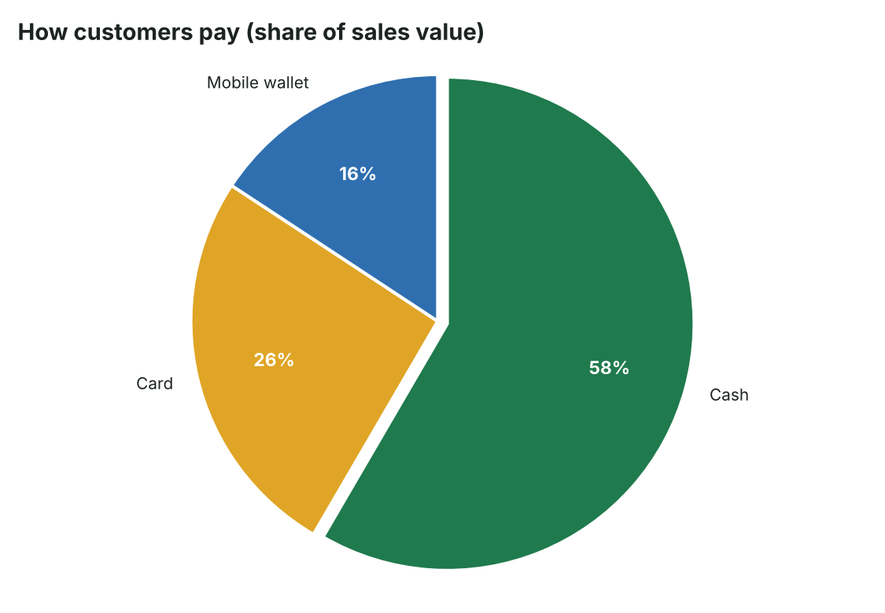

# Mama Zulu's Spaza, Greytown: sales report

Period: **01 Jan 2025 to 31 Dec 2025**

## Headline numbers

| Measure | Value |
|---|---|
| Sales | R 1 492 200.89 |
| Gross profit | R 286 606.19 |
| Gross margin | 19.2% |
| Items sold | 79 040 |
| Trading days | 365 |
| Average sales per day | R 4 088.22 |

## Key findings

- The shop made R 1 492 200.89 in sales and R 286 606.19 gross profit (19.2% margin) over 365 trading days.
- Best month was December (R 166 171.25); quietest was January (R 109 380.65).
- White bread loaf is the biggest earner, bringing in R 27 968.86 profit (9.8% of the total).
- Payday days (25th to 3rd) average 68% more sales than the rest of the month: stock up on bulk staples before the 25th.
- Sunday is the busiest day and Tuesday the quietest.
- The busiest hour is 17:00, so restock shelves before then.
- Airtime & data has the thinnest margin (6.0%): it brings customers in but earns little on its own.

## Monthly trend

| month    | revenue      | profit      | margin_pct   | change_pct   |
|:---------|:-------------|:------------|:-------------|:-------------|
| Jan 2025 | R 109 380.65 | R 21 131.80 | 19.3%        |              |
| Feb 2025 | R 112 901.14 | R 21 924.74 | 19.4%        | 3.2%         |
| Mar 2025 | R 117 168.54 | R 22 432.49 | 19.1%        | 3.8%         |
| Apr 2025 | R 119 453.47 | R 22 725.27 | 19.0%        | 2.0%         |
| May 2025 | R 128 962.75 | R 24 735.70 | 19.2%        | 8.0%         |
| Jun 2025 | R 122 315.21 | R 23 099.06 | 18.9%        | -5.2%        |
| Jul 2025 | R 129 486.75 | R 25 015.00 | 19.3%        | 5.9%         |
| Aug 2025 | R 128 733.44 | R 24 830.29 | 19.3%        | -0.6%        |
| Sep 2025 | R 114 188.38 | R 21 651.28 | 19.0%        | -11.3%       |
| Oct 2025 | R 118 359.96 | R 22 407.91 | 18.9%        | 3.7%         |
| Nov 2025 | R 125 079.35 | R 24 209.10 | 19.4%        | 5.7%         |
| Dec 2025 | R 166 171.25 | R 32 443.55 | 19.5%        | 32.9%        |

## Best products

| product          | category        | units   | revenue      | profit      | margin_pct   |
|:-----------------|:----------------|:--------|:-------------|:------------|:-------------|
| White bread loaf | Bread & bakery  | 8 014   | R 160 199.86 | R 27 968.86 | 17.5%        |
| Vetkoek (each)   | Bread & bakery  | 9 471   | R 47 355.00  | R 27 465.90 | 58.0%        |
| Maize meal 5kg   | Groceries       | 1 444   | R 108 285.56 | R 17 313.56 | 16.0%        |
| Cold drink 2L    | Drinks          | 2 638   | R 73 837.62  | R 17 120.62 | 23.2%        |
| Cold drink 500ml | Drinks          | 4 468   | R 62 507.32  | R 16 933.72 | 27.1%        |
| Maize meal 10kg  | Groceries       | 789     | R 110 452.11 | R 16 561.11 | 15.0%        |
| Brown bread loaf | Bread & bakery  | 4 741   | R 85 290.59  | R 15 123.79 | 17.7%        |
| Chips 125g       | Snacks & sweets | 2 995   | R 50 885.05  | R 13 747.05 | 27.0%        |
| Fresh milk 1L    | Dairy & eggs    | 3 016   | R 69 337.84  | R 11 430.64 | 16.5%        |
| Sweets (loose)   | Snacks & sweets | 17 108  | R 17 108.00  | R 9 409.40  | 55.0%        |

## Slow movers

These earn the least profit. Consider stocking less, re-pricing or bundling them.

| product             | units   | revenue     | profit     | margin_pct   |
|:--------------------|:--------|:------------|:-----------|:-------------|
| Airtime R10         | 3 822   | R 38 220.00 | R 2 293.20 | 6.0%         |
| Airtime R29         | 1 723   | R 49 967.00 | R 2 929.10 | 5.9%         |
| Instant coffee 200g | 273     | R 17 742.27 | R 3 000.27 | 16.9%        |
| Data 1GB            | 605     | R 59 895.00 | R 3 630.00 | 6.1%         |
| Matches 10s         | 1 218   | R 15 821.82 | R 4 738.02 | 29.9%        |

## Categories

| category           | revenue      | profit      | revenue_share_pct   | margin_pct   |
|:-------------------|:-------------|:------------|:--------------------|:-------------|
| Groceries          | R 468 613.49 | R 76 691.09 | 31.4%               | 16.4%        |
| Bread & bakery     | R 292 845.45 | R 70 558.55 | 19.6%               | 24.1%        |
| Household & energy | R 176 034.05 | R 36 138.45 | 11.8%               | 20.5%        |
| Drinks             | R 164 983.48 | R 40 002.08 | 11.1%               | 24.2%        |
| Dairy & eggs       | R 152 014.90 | R 25 673.50 | 10.2%               | 16.9%        |
| Airtime & data     | R 148 082.00 | R 8 852.30  | 9.9%                | 6.0%         |
| Snacks & sweets    | R 89 627.52  | R 28 690.22 | 6.0%                | 32.0%        |

## When customers shop

## Seasonal stock

## How customers pay

| payment_method   | sales   | revenue      | share_of_value_pct   |
|:-----------------|:--------|:-------------|:---------------------|
| Cash             | 35 291  | R 871 315.56 | 58.4%                |
| Card             | 13 687  | R 386 233.86 | 25.9%                |
| Mobile wallet    | 8 851   | R 234 651.47 | 15.7%                |
